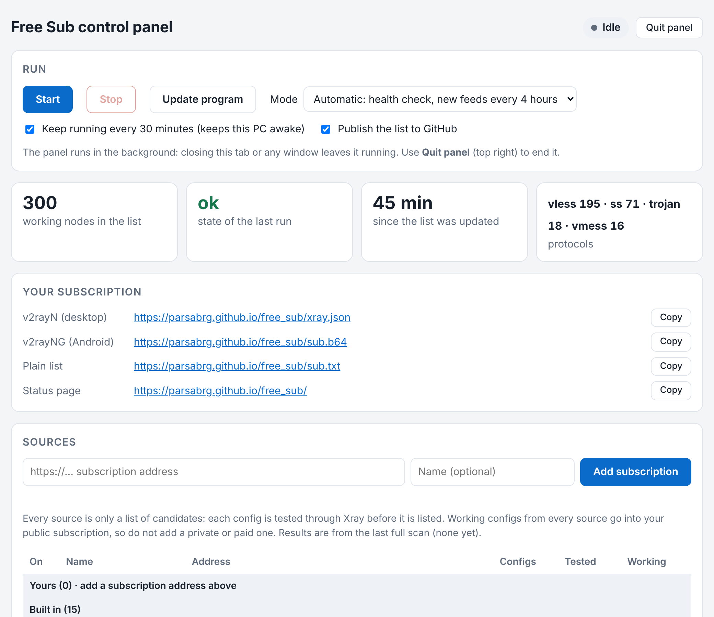

# Free Sub

[](https://github.com/Parsabrg/free_sub/actions/workflows/ci.yml)

Free Sub builds a public proxy subscription that lists only configurations which
recently carried real traffic. It collects public VLESS, VMess, Trojan and
Shadowsocks share links, sends HTTPS requests through each one with the official
Xray core on a Windows PC, remembers how reliable each node has been, and publishes
up to 300 working ones to GitHub Pages.

Tests run on the operator's own network, so "working" means "working from there".

## Subscription addresses

| Client | Address |
|---|---|
| v2rayN (desktop) | `https://parsabrg.github.io/free_sub/xray.json` |
| v2rayNG (Android) | `https://parsabrg.github.io/free_sub/sub.b64` |
| Other clients, plain share links | `https://parsabrg.github.io/free_sub/sub.txt` |
| Status page and test report | `https://parsabrg.github.io/free_sub/` and `status.json` |

Use the **Xray core** in your client and refresh about once an hour. Passing an
Xray test does not establish compatibility with sing-box. The `xray.json` feed
carries the tested Xray outbounds unchanged and is meant for desktop v2rayN.

## What it does

- **Finds its own sources.** Besides a built-in list of public feeds, it searches
  GitHub daily for recently updated collectors and samples what they publish. You
  can add your own subscription addresses and switch any source off.
- **Tests with real traffic.** Every candidate runs in its own Xray process and must
  return certificate-verified HTTPS responses. Unsupported or insecure settings are
  rejected rather than simplified.
- **Measures your real network.** Test connections are bound to the PC's physical
  network adapter, so a VPN or TUN client can stay on without changing the result.
- **Keeps what keeps working.** Nodes are ranked by recent reliability, rechecked
  every 30 minutes, and dropped six hours after their last success.
- **Runs from a control panel or unattended.** Start and stop it from a local page,
  or install a scheduled task that wakes the PC and runs without anyone present.

## Quick start (Windows)

Requirements: Windows 10/11 x64, Python 3.11 or newer, Git for Windows. There are no
pip packages to install, and the pinned Xray binary comes with the repository.

```powershell
git clone https://github.com/Parsabrg/free_sub.git
cd free_sub
```

Then double-click `panel_windows.bat`. A page opens in your browser: press **Start**.
The panel itself runs in the background, without a window of its own.

Publishing needs a one-time Git sign-in and GitHub Pages switched on for the
repository. Both, and the unattended scheduled task, are covered step by step in
[guide/setup.md](guide/setup.md).

## Control panel



`panel_windows.bat` (or `python app.py`) starts the panel as a background program with
no window of its own and opens its page at `http://127.0.0.1:8765/`. Closing the
browser tab, or the brief window the launcher shows, does not stop it. Running the
launcher again while the panel is up simply opens the page again.

- **Start / Stop.** Start one run, or keep running every 30 minutes while the panel
  is open. Stop ends the run and every Xray process it started.
- **Mode.** Automatic (health check each run, new feeds every four hours), a full
  scan now, or a health check only.
- **Publish the list to GitHub.** Untick it to test without pushing.
- **Your subscription.** The published addresses, each with a Copy button.
- **Sources.** Add your own `https://` subscription address, switch any source on
  or off, and see how many configs each one carried and how many worked.
- **Update program.** Fetches the newest version of this repository.
- **Quit panel.** Stops any run and the repeat schedule, then ends the panel program.
- **Log.** The live output of the current run, with a progress bar.

While it repeats, the panel keeps Windows from idle-sleeping. It cannot wake a
sleeping PC, and it ends when Windows signs out or restarts. If the page shows
**Panel stopped**, the program ended (it was quit, killed, or crashed); start it
again with `panel_windows.bat`. A crash is recorded in `.local\logs\panel.log`. The
page is served to this computer only.

## Running without the panel

```powershell
python main.py --mode auto --publish      # what the panel and the task run
python main.py --mode full                # full scan, nothing published
python main.py --mode health --publish    # recheck the current list only
python verify.py --xray .\tools\xray.exe  # the complete test gate
```

For runs with nobody present, including waking the PC from sleep, install the
scheduled task: see [guide/setup.md](guide/setup.md#unattended-runs-scheduled-task).

## How it works

1. **Collect** share links from the built-in feeds, your own, and feeds found on
   GitHub. A blocked fetch is retried through an already verified node.
2. **Parse** each link strictly into an Xray outbound; duplicates are merged by
   their effective configuration, not by name.
3. **Screen** every candidate: a certificate-verified HTTPS request through its own
   Xray process, with a five-second network deadline.
4. **Verify** the best candidates again in a new process: two transfers to two
   different sites within 30 seconds.
5. **Select** up to 300 by recent reliability, at most four per server address.
6. **Publish** the list after the test suite, including real Xray end-to-end tests,
   has passed on the PC.

Details, limits and the reasons behind them are in
[guide/how-it-works.md](guide/how-it-works.md).

## Documentation

| Document | Contents |
|---|---|
| [guide/setup.md](guide/setup.md) | One-time setup, GitHub Pages, the scheduled task, updating, troubleshooting, removal |
| [guide/how-it-works.md](guide/how-it-works.md) | Sources, parsing rules, tests, ranking, names, expiry, what is not certified |
| [guide/reference.md](guide/reference.md) | Command-line options, files and folders, `status.json` fields, log messages |
| [guide/validation.md](guide/validation.md) | Test evidence recorded during development |
| [CHANGELOG.md](CHANGELOG.md) | What changed and when |
| [tools/README.md](tools/README.md) | Origin, hash and license of the bundled Xray binary |

## Limits and safety

- The published nodes are public proxies run by unknown operators. A passing HTTPS
  test is not a privacy audit and says nothing about who operates a node.
- Publishing makes the listed proxy credentials public. Never add a private or paid
  subscription as a source.
- Results describe the operator's network at test time. Other networks and ISPs can
  behave differently.
- Testing public proxies exposes the PC's IP address and connection metadata to
  their operators.
- No UDP, DNS-leak, sustained-speed or gaming-latency measurement is made.

## Sources and acknowledgments

Candidate feeds come from the projects below. Thanks to their maintainers. This
project tests candidates independently; listing a source does not imply that its
maintainers endorse this project or vouch for the proxy operators.

| Resource | Published repository license / terms |
|---|---|
| [Barry](https://github.com/barry-far/V2ray-Config) | MIT |
| [Shadowmere](https://shadowmere.xyz/) | Check the provider's terms |
| [0xRadikal](https://github.com/0xRadikal/Free-v2ray-Configs) | MIT |
| [Pawdroid](https://github.com/Pawdroid/Free-servers) | No license detected by GitHub; check upstream terms |
| [Mahdibland / V2RayAggregator](https://github.com/mahdibland/V2RayAggregator) | GPL-3.0; public `Eternity.txt` feed only |
| [Patterniha](https://github.com/patterniha/Free-Configs) | MIT |
| [Whitedns](https://github.com/iampedii/whitedns-sub) | No license detected by GitHub; check upstream terms |
| [Kahrobas](https://bot.kahrobas.shop/sub.txt) | Check the provider's terms |
| [ALIILAPRO](https://github.com/ALIILAPRO/v2rayNG-Config) | GPL-3.0 |
| [Ermaozi](https://github.com/ermaozi/get_subscribe) | GPL-3.0 |
| [MatinGhanbari](https://github.com/MatinGhanbari/v2ray-configs) | MIT |
| [hamedcode](https://github.com/hamedcode/port-based-v2ray-configs) | GPL-3.0 |
| [MohammadBahemmat](https://github.com/MohammadBahemmat/V2ray-Collector), [morpheusadam](https://github.com/morpheusadam/v2ray-config) | No license detected by GitHub; check upstream terms |
| [XTLS / Xray-core](https://github.com/XTLS/Xray-core) | MPL-2.0; unmodified official Windows binary and its license in `tools/` |

Feeds found automatically are not in this table and nobody has checked their
licenses. `status.json` names each one (`gh:owner/repository`) on every discovery
run; switch one off in the control panel, or all of them with `--found-sources 0`.

License metadata was checked on 2026-10-15 (ALIILAPRO, Ermaozi and MatinGhanbari on
2026-10-26) and may change. Consult each upstream license and keep required
copyright and license notices when redistributing covered material. A repository's
software license does not by itself establish permission from every proxy operator
to redistribute credentials, attribution is not a substitute for permission, and
public visibility alone does not grant a general license to reuse.
